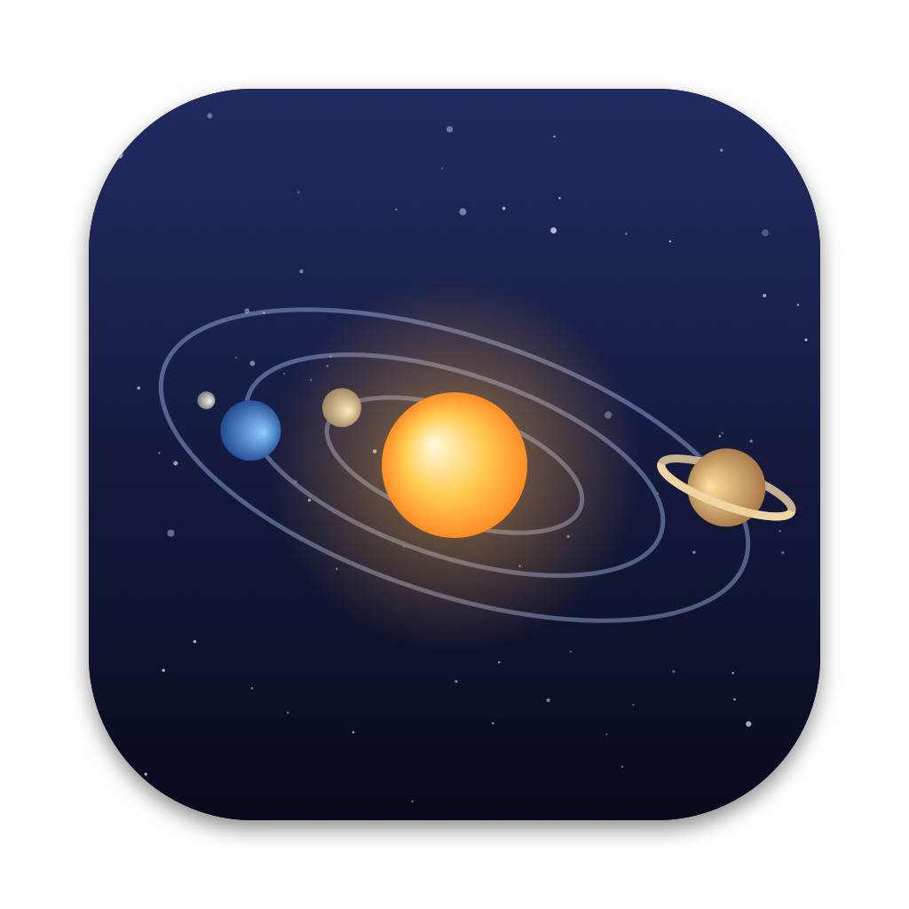
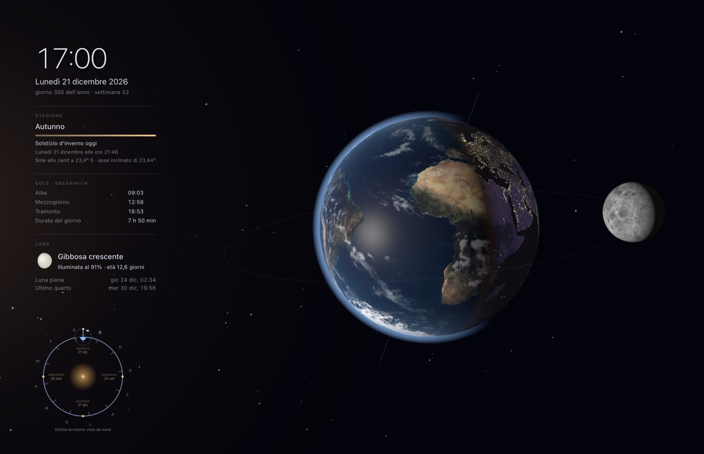

# Astro Sfondo

Sfondo animato per macOS che mostra la Terra, la Luna e le stagioni **come sono in questo
istante**: una sorta di calendario perpetuo astronomico sulla Scrivania.



*Il solstizio d'inverno 2026 alle 17:00 (ora italiana), con la località predefinita Greenwich.*

> **English summary.** A live macOS desktop wallpaper showing the Earth as it is right now:
> real rotation, day/night terminator with city lights, axial tilt relative to the Sun through
> the seasons, the Moon at its true position and phase, a heliocentric orrery and an almanac
> panel (sunrise/sunset, season, moon phases). Native Swift wrapper around a WebGL page
> (three.js), with low-precision ephemerides validated against PyEphem. UI is in Italian;
> translations and contributions are welcome. License: AGPL-3.0-only.

## Cosa mostra

- **La Terra in tempo reale**: rotazione secondo il tempo siderale, notte con le luci delle
  città, asse inclinato di 23,44° che si volge verso il Sole o lontano da esso con le stagioni,
  e un puntino sul luogo scelto.
- **La Luna** nella posizione reale sulla sua orbita, con la faccia visibile rivolta alla Terra.
- **Un pannello-calendario**: ora, data, giorno dell'anno e settimana; stagione con avanzamento
  e prossimo equinozio o solstizio; alba, mezzogiorno, tramonto e durata del giorno; fase,
  illuminazione ed età della Luna con le fasi successive.
- **Un planetario** visto dal polo nord dell'eclittica: orbita terrestre con mesi, equinozi,
  solstizi, l'asse e la Luna.
- **Animazioni d'ambiente leggere**: le stelle brillano, le nuvole scorrono lentamente.

## Precisione

`web/astro.js` usa effemeridi a bassa precisione, confrontate con PyEphem su più date:

| Grandezza | Scarto massimo |
|---|---|
| Posizione del Sole | 0,003° |
| Posizione della Luna | 0,04° |
| Rotazione terrestre (tempo siderale) | 1,2 s |
| Fasi lunari | 9 min |
| Equinozi e solstizi | 7 min |
| Alba e tramonto | 2 s |

Elementi decorativi e non reali: le nuvole sono un'immagine fissa che scorre, e la distanza della
Luna è ridotta per farla stare sullo schermo.

## Requisiti

- macOS 14 o successivo, Apple Silicon o Intel
- Command Line Tools di Apple: `xcode-select --install`

## Installazione

```bash
git clone https://github.com/EdoardoMariaMontagna/astro-sfondo.git
cd astro-sfondo
./install.sh
```

`install.sh` scarica le immagini di Terra e Luna (vedi
[THIRD_PARTY_NOTICES.md](THIRD_PARTY_NOTICES.md)), compila l'app in `/Applications/Astro Sfondo.app`
(serve un utente amministratore) e attiva due avvii automatici: l'app all'accesso e la verifica
giornaliera.

Per disinstallare, rimettendo lo sfondo precedente: `./uninstall.sh`.

### Firma e Gatekeeper

L'app è compilata e firmata "ad hoc" sul tuo Mac: non ha l'attributo di quarantena dei file
scaricati, quindi Gatekeeper la autorizza senza avvisi. Non serve, e non è consigliabile,
disattivare Gatekeeper o usare "Apri comunque". Una firma Developer ID con notarizzazione Apple
servirebbe solo per distribuire l'app già compilata, non per chi la compila da questo repository.

## Uso e personalizzazione

- L'icona del **mappamondo** nella barra dei menu mostra l'esito dell'ultima verifica e permette
  di ricaricare lo sfondo, mettere in pausa le animazioni o uscire. Uscendo dal menu si rimette
  lo sfondo originale.
- Aprire **Astro Sfondo** da `/Applications` o dal Launchpad la riavvia se era stata chiusa,
  oppure apre il suo menu se è già attiva: non partono mai due sfondi sovrapposti.
- Il luogo (predefinito: Greenwich), i fotogrammi al secondo e la distanza della Luna sono in
  `web/config.js`. Per personalizzarli crea `web/config.local.js`, escluso da git, con solo le voci
  da cambiare:
  ```js
  export const CONFIG = { location: { name: 'Napoli', lat: 40.8518, lon: 14.2681 } };
  ```
  Gli orari si mostrano nel fuso orario del Mac. Le modifiche a `web/` si vedono con "Ricarica lo
  sfondo", senza ricompilare. Per `app/main.swift` serve invece `./build.sh`.
- Per provare altre date:
  `"/Applications/Astro Sfondo.app/Contents/MacOS/AstroSfondo" --query "?t=2027-06-21T12:00:00Z&speed=3600"`
- L'icona è disegnata da `app/icona.swift`: dopo averla modificata, `swift app/icona.swift` rigenera
  `app/AppIcon.icns` e poi `./build.sh` la installa.

## Come funziona

```
app/main.swift   finestra al livello della Scrivania (sotto le icone, su tutti gli Spaces)
                 con una WKWebView; serve web/ con lo schema astro:// perché WebGL
                 richiede texture della stessa origine; ogni 3 minuti imposta come sfondo
                 di sistema un'istantanea della scena, che macOS mostra mentre si spostano
                 i widget o in Mission Control
web/astro.js     effemeridi (Sole, Luna, fasi, stagioni, alba e tramonto)
web/main.js      scena three.js: eclittica orizzontale, scena che ruota con il Sole
                 (illuminazione sempre da sinistra), asse inclinato, rotazione siderale
web/panel.js     pannello-calendario
web/orrery.js    planetario 2D
verifica.sh      verifica automatica (all'accesso e alle 13): app attiva, firma, blocchi di
                 Gatekeeper, scena davvero disegnata (luminosità del globo in un'istantanea),
                 sfondo di sistema; ripara riavviando o ricompilando dai sorgenti locali;
                 segnala nuove versioni di three.js senza installarle
```

L'app non fa connessioni di rete. Consumo misurato su un M1 Pro: circa il 13% di un core e
340 MB di memoria, con pausa automatica a schermo spento o Scrivania coperta.

## Contribuire

Idee e richieste di modifica sono benvenute, per esempio:

- immagini di pubblico dominio NASA al posto di quelle attuali (vedi
  [THIRD_PARTY_NOTICES.md](THIRD_PARTY_NOTICES.md));
- traduzione dell'interfaccia;
- stelle e costellazioni reali da un catalogo;
- aggiornamento a una versione più recente di three.js.

## Licenza

Copyright (C) 2026 Edoardo Maria Montagna

Questo programma è software libero: puoi ridistribuirlo e/o modificarlo secondo i termini della
GNU Affero General Public License, versione 3 (solo la versione 3), come pubblicata dalla Free
Software Foundation. È distribuito nella speranza che sia utile, ma SENZA ALCUNA GARANZIA. Il
testo completo è in [LICENSE](LICENSE).

SPDX-License-Identifier: `AGPL-3.0-only`
